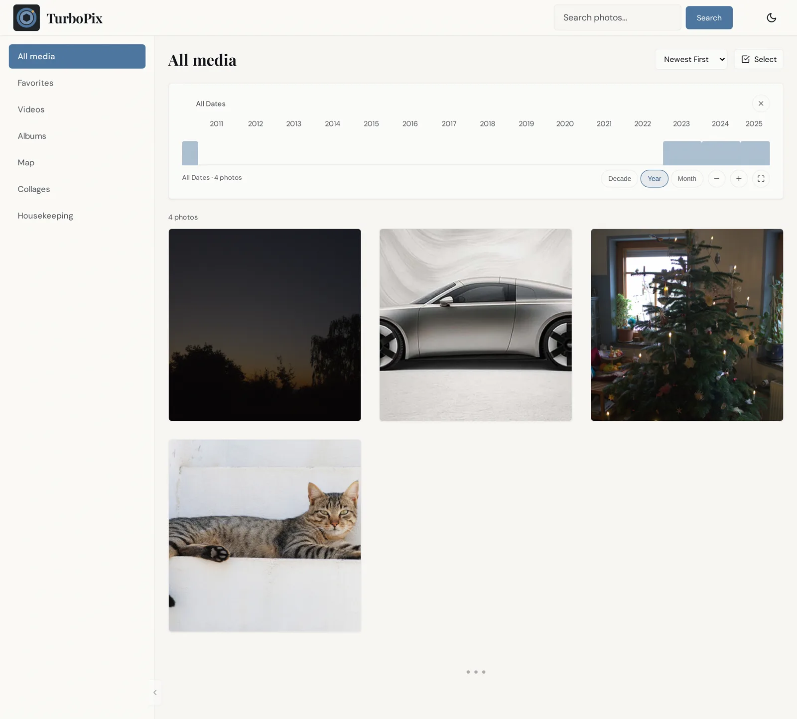

<p align="center">
  
</p>

<p align="center">
  <a href="https://github.com/RouHim/turbo-pix/actions/workflows/ci.yml"></a>
  <a href="https://github.com/RouHim/turbo-pix/releases/latest"></a>
  <a href="https://hub.docker.com/r/rouhim/turbo-pix"></a>
  <a href="https://hub.docker.com/r/rouhim/turbo-pix/tags"></a>
  <a href="https://buymeacoffee.com/rouhim"></a>
</p>

<p align="center">
  Browse, search and organize your own photo and video collection in place with a single self-hosted binary.
</p>

<p align="center">
  
</p>

## Motivation

After moving from cloud photo services to self-hosted tools, I wanted a gallery that opens the folders I already have.
TurboPix keeps that layout untouched and adds browsing, search and organization on top.

## How it works

At startup TurboPix scans the configured folders, reads EXIF metadata, and builds a local database, a thumbnail cache
and a search index for the library. A scan runs again every night, and Housekeeping can start one on demand
(`POST /api/indexing/scan`).

The interface reads from that database. Image and video files are opened only to show them or to carry out an action
you trigger, such as a metadata edit, a rotation or a deletion.

## Features

- Browse photos and videos in a date grid with a timeline for decades, years and months.
- Search by description, camera or filename.
- Plot geotagged photos on a map, clustered by place, with a mini map in the viewer.
- Group detected faces into people and filter the grid by person.
- Inspect camera settings, capture date and GPS coordinates in the viewer.
- Mark favorites and create albums.
- Select many items to favorite, export, delete or add to an album.
- Build collages from any day in the last 30 days that holds at least ten photos, then accept or reject them.
- Review duplicates and other issues in Housekeeping.
- Edit photo and video metadata, rotate photos, and delete files.
- Switch between light and dark themes.
- Use the same interface on phones and tablets.
- Browse RAW files from Canon, Nikon, Sony, Fujifilm, Olympus, Panasonic, Pentax and Adobe.

## Run the application

```shell
docker run -p 18473:18473 \
  -v /path/to/pictures:/photos \
  -v ./data:/data \
  rouhim/turbo-pix
```

Open <http://localhost:18473>. The photo mount must be writable because metadata edits, rotation and deletion write
into the library; a read-only mount answers those actions with `403`.

TurboPix binds `0.0.0.0` by default so it is reachable from your LAN, and it has no login: anyone who can reach port
18473 can browse and permanently delete photos. Keep it on a trusted network and never publish it to the internet.

### Prerequisites

Docker Engine for the container image. The image includes ffmpeg 9.0.

The native binary needs Linux on `x86_64` or `aarch64`, with ffmpeg and ffprobe on `PATH`.

### Docker Compose

```yaml
services:
  turbo-pix:
    image: rouhim/turbo-pix
    volumes:
      - /path/to/pictures:/photos
      - ./data:/data
    ports:
      - '18473:18473'
```

### Native binary

Releases provide static Linux binaries for `x86_64` and `aarch64`. Download the one that matches your machine:

```shell
curl -L -o turbo-pix https://github.com/RouHim/turbo-pix/releases/latest/download/turbo-pix-x86_64-unknown-linux-musl
chmod +x turbo-pix
```

On ARM64, use `turbo-pix-aarch64-unknown-linux-musl` in the URL. Start it with:

```shell
mkdir -p data
TURBO_PIX_PHOTO_PATHS=/path/to/pictures \
TURBO_PIX_DATA_PATH=./data \
./turbo-pix
```

The first start downloads the CLIP and face models, about 870 MB, into the data directory and indexes the library.
Later starts only process new or changed files. To fetch the models first, run `./turbo-pix --download-models`, or in
Docker `docker run --rm -v ./data:/data rouhim/turbo-pix --download-models`.

## Configuration

TurboPix is configured with environment variables.

| Name                               | Description                                                                                    | Default value                                    | Example                                          |
| ---------------------------------- | ---------------------------------------------------------------------------------------------- | ------------------------------------------------ | ------------------------------------------------ |
| `TURBO_PIX_PHOTO_PATHS`            | Comma-separated folders to scan                                                                | `./photos`                                       | `/photos,/mnt/videos`                            |
| `TURBO_PIX_DATA_PATH`              | Database, thumbnails, transcode cache and models                                               | `./data`                                         | `/data`                                          |
| `TURBO_PIX_PORT`                   | HTTP port                                                                                      | `18473`                                          | `8080`                                           |
| `TURBO_PIX_LOCALE`                 | UI language and date format (`en` or `de`)                                                     | `en`                                             | `de`                                             |
| `TURBO_PIX_FACE_RECOGNITION`       | Face detection and the People view; existing data is kept when disabled                        | `true`                                           | `false`                                          |
| `TURBO_PIX_TILE_URL`               | Raster tile endpoint for the map                                                               | `https://tile.openstreetmap.org/{z}/{x}/{y}.png` | `https://tiles.example.com/{z}/{x}/{y}.png`      |
| `FFMPEG_PATH`                      | ffmpeg binary                                                                                  | `ffmpeg`                                         | `/usr/bin/ffmpeg`                                |
| `FFPROBE_PATH`                     | ffprobe binary                                                                                 | `ffprobe`                                        | `/usr/bin/ffprobe`                               |
| `RUST_LOG`                         | Log level                                                                                      | `error` native, `info` container                 | `debug`                                          |

`RUST_LOG` defaults to `error` in a native run and `info` in the container image and compose file.

There is no bind-address knob: the server listens on `0.0.0.0` so the LAN can reach it. Restrict reachability with a
firewall or the container's port mapping. Transcode concurrency (half the cores, 1–4), the 900 s whole-file and 300 s
stream-stall timeouts, the 20 s conversion-slot wait and the 2 GiB thumbnail-cache ceiling are fixed defaults; the
transcode cache always lives at `{DATA_PATH}/cache/transcoded`.

## Limitations

- HEIC support is limited by [image-rs issue #1375](https://github.com/image-rs/image/issues/1375).
- iOS Live Photos are indexed as separate image and video files.
- Run one instance per data directory. The scan lock coordinates triggers inside one process, not across processes.
- Face recognition downloads model weights that are licensed for non-commercial use only. They are not covered by the
  MIT license; see [NOTICE](NOTICE).

## Supported platforms

- OS: Linux. Release binaries are static musl builds for `x86_64` and `aarch64`; macOS and Windows are not built or
  tested.
- Browsers: Chromium. The Playwright suite runs one Chromium project; Firefox and Safari are untested.
- ffmpeg: 9.0 in the container image; a native run uses the `ffmpeg` and `ffprobe` on `PATH`.

## Supported formats

### Images

JPEG, PNG, GIF, WebP, BMP and TIFF. RAW files: CR2, CR3, NEF, NRW, ARW, SRF, SR2, RAF, ORF, RW2, DNG and PEF.

### Videos

MP4, MOV, AVI, MKV, WebM and M4V.

## Resources

- [HTTP API reference](docs/API.md)
